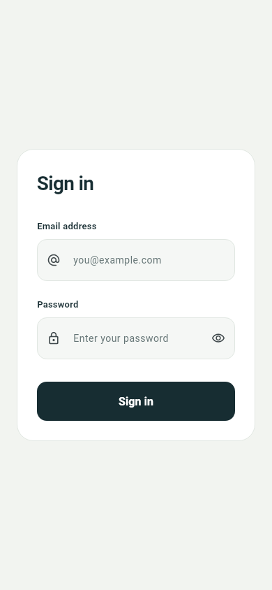

# Flutter Login

A simple, responsive Flutter login page with email and password fields, input validation, and a password visibility toggle.

## Screenshot



## Run locally

Install the [Flutter SDK](https://docs.flutter.dev/install), then run:

```sh
git clone https://github.com/EF-Code/flutter-login.git
cd flutter-login
flutter pub get
flutter run
```

Android, iOS, and web project files are included. To run in Chrome:

```sh
flutter run -d chrome
```

## Development

```sh
dart format lib test
flutter analyze
flutter test
```

Authentication is not connected. The sign-in handler in `lib/main.dart` validates the form and provides the integration point for an authentication service.
